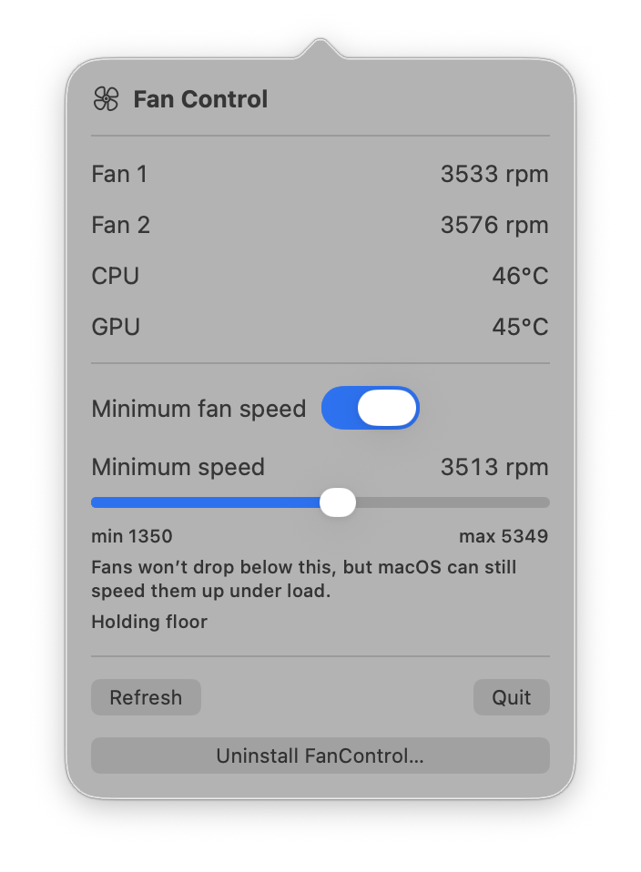

<p align="center">
  
</p>

<h1 align="center">Fan Control</h1>

<p align="center">
  A tiny, dependency-free fan controller for Apple Silicon Macs —
  a menu bar app <em>and</em> a CLI, sharing one SMC core.
</p>

---

Give your Mac's fans a **minimum speed floor** — or hand them fully back to
macOS — straight from the menu bar or the terminal. The floor keeps the fans
from idling too slow for your taste while leaving the firmware free to ramp them
*higher* under load; macOS stays the thermal boss at all times. No kernel
extensions, no background daemons, no third-party libraries — just a direct
read/write conversation with the **System Management Controller (SMC)** over
IOKit.

> The power-user CLI can still hard-pin the fans to an exact RPM (`fan set`), but
> the menu bar app only ever raises the *minimum* — it never caps how fast the
> fans are allowed to go.

> Built and verified on a MacBook Pro (M5 Pro, macOS 26). **Apple Silicon only.**

<p align="center">
  
</p>

## Features

- 📊 **Live RPM readout** for every fan
- 🌡️ **CPU & GPU temperatures**, shown in your system's unit (°C / °F)
- 🎚️ **Minimum fan speed** floor with a slider — fans never idle below it, but
  the firmware can still ramp them higher under load
- 🔄 **Automatic** at any time — flip the switch off and macOS is fully back in
  control
- 🖥️ A **menu bar app** (number-only readout) **and** a `fan` **CLI**, on one core
- 🔐 **Passwordless after one prompt** — the app installs a tightly-scoped
  `sudo` rule for its fan helper automatically, so it only asks for your admin
  password once
- 🚀 **Launch at login**, registered automatically on first run
- 🗑️ **One-click uninstall** from inside the app

## How it works

The app talks to the SMC via the `AppleSMC` IOKit user client. Each fan exposes a
set of four-character keys:

| Key        | Meaning                                       |
|------------|-----------------------------------------------|
| `FNum`     | number of fans                                |
| `F{n}Ac`   | current RPM (read)                            |
| `F{n}Mn` / `F{n}Mx` | minimum / maximum RPM (**read-only** — see below) |
| `F{n}Tg`   | target RPM (write to set speed)               |
| `F{n}md`   | mode: `0` = automatic, `1` = forced (manual)  |

The only writable controls are the per-fan mode bit `F{n}md` and the target
`F{n}Tg`. To force a fan, the code writes `F{n}md = 1` then `F{n}Tg = <rpm>`; to
hand it back to the firmware it writes `F{n}md = 0`. (It also falls back to the
legacy uppercase `F{n}Md` / `FS!` keys used by older Macs.)

Temperatures are read by averaging the SMC's `Tp*` (performance-core) and `Tg*`
(GPU) `flt` sensors into one figure each, and shown in whatever unit you've set
in **System Settings → Language & Region → Temperature** (°C or °F).

### Minimum fan speed, emulated in software

There is a catch that makes "auto, but never below N rpm" surprisingly hard: on
Apple Silicon the hardware minimum register `F{n}Mn` is **read-only**. The SMC
rejects any write to it (error `0x86`), so there is *no* native "auto-with-a-floor"
hardware mode to set. The app emulates one using the only writable controls
(`F{n}md` + `F{n}Tg`), deciding per fan on a short timer:

- **Firmware already wants ≥ the floor** (the machine is under load): leave the
  fan in firmware **AUTO** so it ramps freely — the floor is a non-event.
- **Firmware would idle the fan below the floor** (the machine is cool): force
  the fan up to the floor and hold it there.
- **While a fan is held at the floor**, it is kept **steady**. The app does *not*
  release it on a timer to re-probe the firmware's intent — doing that made the
  fan audibly oscillate. Instead it watches temperature (a read-only signal) and
  hands the fan back to the firmware once temps climb past the point where the
  hold began, at which moment the firmware's live target drives the ramp.

The upshot: the floor only ever *raises* an idle fan; it never prevents the fan
from speeding up.

- **Reading** RPMs and temperatures works as a normal user.
- **Writing** requires **root** — the SMC gates write commands. The app installs
  a scoped passwordless `sudo` helper (see [Permissions & security](#permissions--security));
  the CLI uses `sudo`.
- Automatic control is restored whenever **Minimum fan speed** is switched off,
  and when the app quits or is uninstalled. (A hard pin from the CLI's `fan set`
  persists until you run `fan auto` or reboot — the SMC resets to automatic on
  boot.)
- macOS's thermal manager remains the final safety backstop at all times and will
  override the fans if the machine gets too hot.

## Requirements

- An Apple Silicon Mac **with fans** (MacBook Airs are fanless)
- macOS 13 or later
- Xcode Command Line Tools — `xcode-select --install`

## Build

```sh
git clone https://github.com/SirGian99/mac-fan-control.git
cd mac-fan-control
./build-app.sh
```

This produces:

- `FanControl.app` — the menu bar app
- `.build/release/fan` — the CLI

(For just the binaries: `swift build -c release`.)

## Install the app

```sh
cp -R FanControl.app /Applications/
open /Applications/FanControl.app
```

- The current RPM appears in your **menu bar** (it's a menu-bar app — no dock icon).
- On first launch the app **registers itself as a login item**, so it starts
  automatically at every login.
- The app is **ad-hoc signed**, not notarized. If you copy it to *another* Mac,
  Gatekeeper will block the first launch — right-click the app → **Open**, or run
  `xattr -dr com.apple.quarantine /Applications/FanControl.app`.

## Using the menu bar app

Click the menu bar number to open the panel:

- **Minimum fan speed** — a single on/off switch. Off = fully **Automatic**
  (macOS controls the fans). On = the fans never idle below the chosen RPM, but
  the firmware stays free to ramp them higher under load.
- **Speed** slider (enabled when Minimum is on) — sets the floor, bounded by the
  fans' reported min/max.
- The **first time you turn Minimum on**, the app asks for your admin password
  once to install its passwordless helper; after that it applies changes
  silently (see [Permissions & security](#permissions--security)).
- **Refresh**, **Quit**, and **Uninstall FanControl…** (restores automatic
  control, removes the login item, and moves the app to the Trash).

## Using the CLI

```text
fan [status]              Show fan RPMs and mode           (no root)
fan status --json         Machine-readable status          (no root)
fan keys [F|all|PREFIX]   Dump SMC keys (read-only)        (no root)
sudo fan set <rpm>        Force ALL fans to <rpm> rpm (hard pin)
sudo fan set <rpm> -f N   Force only fan N
sudo fan max              Force all fans to their maximum
sudo fan auto [-f IDX]    Restore automatic control (all fans, or only fan IDX)
sudo fan supervise <rpm> [--interval MS] [--temp-margin C] [--epsilon RPM] [--once]
                          Run the minimum-RPM floor supervisor in the foreground
```

| Command                     | Root? | What it does                                        |
|-----------------------------|:-----:|-----------------------------------------------------|
| `fan` / `fan status`        |  no   | Print each fan's RPM, min/max, target, mode         |
| `fan status --json`         |  no   | Same, as JSON                                       |
| `fan keys [F\|all\|PREFIX]` |  no   | Dump SMC keys; default prefix `F`, `all`/`""` = all |
| `fan set <rpm>`             |  yes  | Hard-pin all fans to `<rpm>` (disables the ramp)    |
| `fan set <rpm> -f <n>`      |  yes  | Hard-pin only fan `<n>`                             |
| `fan max`                   |  yes  | Force all fans to their maximum                     |
| `fan auto [-f <idx>]`       |  yes  | Hand control back to macOS (all fans, or fan `idx`) |
| `fan supervise <rpm>`       |  yes  | Run the minimum-RPM floor supervisor (Ctrl-C stops) |

`fan set` is the classic hard pin: it forces the fans to an exact RPM and
disables the firmware's thermal ramp until you run `fan auto` or reboot. If you
want "never below N rpm, but free to go faster", use `fan supervise` instead —
it runs the exact same minimum-floor logic the menu bar app uses, in the
foreground, and restores automatic control on Ctrl-C. Its knobs: `--interval`
(poll period, default 2000 ms), `--temp-margin` (°C rise above the hold baseline
before a held fan is released, default 10.0), `--epsilon` (RPM slack when
comparing the firmware's target to the floor, default 50), and `--once` (run a
single control step and exit). Before a held fan is actually handed back, the
supervisor verifies it against the firmware's real target — if the firmware
still wants less than the floor, the fan is re-held immediately, so a minor
temperature wiggle can't let it coast down toward 0.

Example:

```sh
$ fan status
Fan 0:  1351 rpm   [min 1350, max 5349]   target 1350   (auto)
Fan 1:  1453 rpm   [min 1350, max 5777]   target 1458   (auto)
CPU: 46°C
GPU: 41°C

$ sudo fan supervise 2500
Minimum-fan-speed supervisor
  floor       = 2500 rpm
  ...
Press Ctrl-C to stop (restores automatic).

$ sudo fan set 3000
Set 2 fan(s) → 3000 rpm (manual)

$ sudo fan auto
Restored automatic fan control
```

Put it on your `PATH` (optional):

```sh
sudo cp .build/release/fan /usr/local/bin/fan
```

## Launch at login

The app registers itself on first launch by writing a per-user LaunchAgent at
`~/Library/LaunchAgents/local.fancontrol.plist`. Helper scripts are included if
you'd rather manage it explicitly:

```sh
./install-login-item.sh     # (re)write and load the LaunchAgent now
./uninstall-login-item.sh   # remove it (leaves the app in place)
```

It also appears under **System Settings → General → Login Items**.

## Permissions & security

Writing fan speed requires root, so controlling the fans at all means the app
needs a way to run its helper as root. It does this by installing a
**tightly-scoped passwordless `sudo` rule** the first time you turn **Minimum
fan speed** on:

- A **root-owned** helper is placed at `/Library/FanControl/fanctl`, plus a
  `/etc/sudoers.d/fancontrol` rule scoped to *only* the fan subcommands.
- You authenticate **once** (a single admin-password prompt); after that the app
  applies changes silently. A one-time first-launch notice explains that this
  prompt is coming. The app reinstalls the helper automatically if it becomes
  stale after an app update.
- Because the directory and helper are root-owned, a non-root user can't swap the
  helper out (no privilege escalation). Trade-off: while installed, any process
  running as your user can change fan speed without a prompt — but the blast
  radius is limited to fan control, nothing else.
- Fully reversible — uninstall from the app, or
  `sudo rm -f /etc/sudoers.d/fancontrol && sudo rm -rf /Library/FanControl`.

The CLI needs no helper: it just runs under `sudo` directly.

## Uninstall

Use the **Uninstall FanControl…** button in the app (restores automatic control,
removes the login item and the passwordless `sudo` helper, and moves the app to
the Trash), or manually:

```sh
./uninstall-login-item.sh
rm -rf /Applications/FanControl.app
sudo rm -f /etc/sudoers.d/fancontrol && sudo rm -rf /Library/FanControl   # the fan helper
```

## Limitations

- **Apple Silicon only** — built for `arm64`; Intel Macs use a different SMC.
- **Not notarized** — expect a one-time Gatekeeper prompt on other Macs.
- SMC write keys are verified on **M5**; other Apple Silicon generations share the
  same key families and the code falls back gracefully, but writes there are
  unverified.

## License

[MIT](LICENSE)
